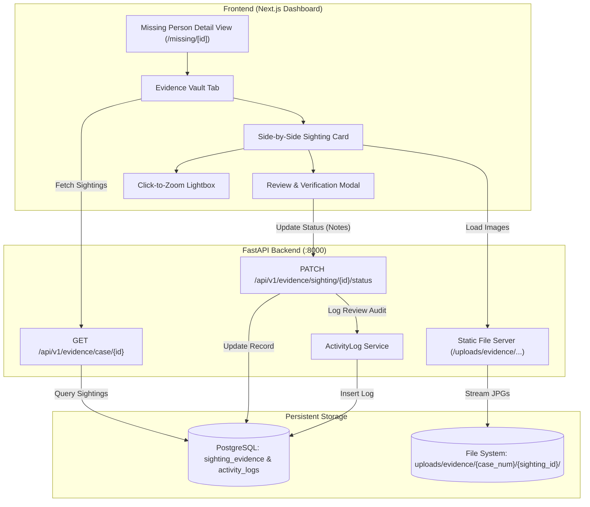
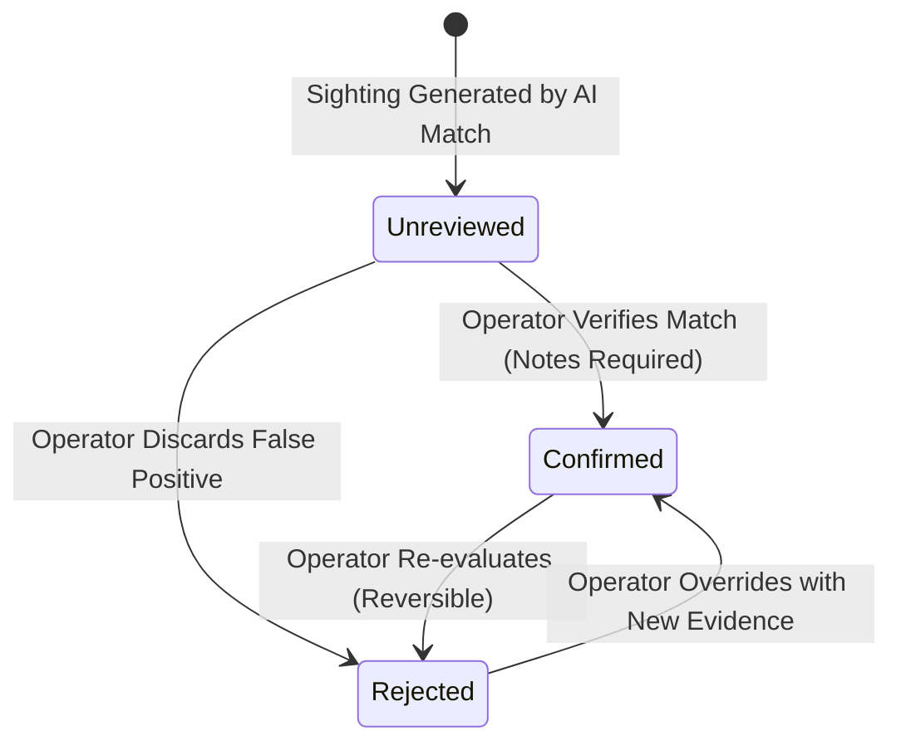

# Phase 2.1: Evidence Vault & Verification Architecture - Research

**Researched:** 2026-11-15  
**Domain:** Forensic Media Storage, Sighting Evidence Verification State Machine, Next.js Evidence Gallery UI  
**Confidence:** HIGH  

<user_constraints>
## User Constraints (from CONTEXT.md)

### Locked Decisions
- **Data Model:** Dedicated `SightingEvidence` model in `database/models/system.py` (or `ai_events.py`) linked to `MissingPerson`, `DetectionEvent`, and `User`.
  - Fields: `id` (UUID), `detection_event_id` (UUID, nullable), `missing_person_id` (UUID), `crop_image_path` (String), `full_frame_path` (String), `similarity_score` (Float), `quality_score` (Float, blur/sharpness Laplacian variance), `model_version` (String, e.g. "Facenet512-v1"), `verification_status` (Enum/String: "Unreviewed", "Confirmed", "Rejected"), `reviewed_by_id` (UUID User, nullable), `reviewed_at` (DateTime, nullable), `review_notes` (Text, nullable), `bounding_box` (JSON: {x, y, w, h}).
- **Verification State Machine:**
  - Initial state: `Unreviewed`
  - Transitions:
    - `Unreviewed` → `Confirmed`
    - `Unreviewed` → `Rejected`
    - `Confirmed` ↔ `Rejected` (reversible by operator)
  - Review Modal: Investigator must be able to input review notes (e.g. "Subject verified wearing same red jacket").
  - Audit Trail: Writes an immutable record to `ActivityLog` on every status transition with user ID, action, sighting ID, and prior/new status.
  - Case Lead Indication: When at least one sighting is `Confirmed`, Missing Person case displays a prominent "Confirmed Sighting Lead" badge.
- **Evidence Vault UI:**
  - Dedicated "Evidence Vault" tab in the Missing Person case details view in `apps/web-dashboard/src/app/missing/`.
  - Side-by-side comparison cards: Reference Photo vs CCTV Face Crop vs Full Frame.
  - Lightbox modal: Click-to-zoom for forensic inspection of high-resolution full frames and face crops.
  - UI/UX Compliance: Adheres to `.agents/skills/ui-ux-pro-max` guidelines for data-dense dashboards, accessible dialogs, and high-contrast status badges.
- **Hierarchical Media Storage:**
  - Path: `services/backend/uploads/evidence/{case_number}/{sighting_id}/`
  - Contents: `crop.jpg` and `full_frame.jpg`
  - Served via FastAPI static mount `/uploads/evidence/...`.

### the agent's Discretion
- Image thumbnailing & blur estimation algorithm: OpenCV Laplacian variance $\sigma^2(\nabla^2 I)$ for `quality_score`.
- FastAPI endpoint design:
  - `POST /api/v1/evidence/sighting`: Create sighting record with file uploads.
  - `GET /api/v1/evidence/case/{case_id}`: Fetch all sighting evidence for a case.
  - `PATCH /api/v1/evidence/sighting/{sighting_id}/status`: Toggle status, write review notes, log audit entry.
- Alembic migration naming: `add_sighting_evidence_table`.

### Deferred Ideas (OUT OF SCOPE)
- Vector database migration (pgvector / Qdrant) — deferred to Phase 3.
- Automated multi-camera trajectory tracking — deferred to Phase 4.2.
- RTSP live stream integration — deferred to Phase 4.1.
</user_constraints>

---

<architectural_responsibility_map>
## Architectural Responsibility Map

| Capability | Primary Tier | Secondary Tier | Rationale |
|---|---|---|---|
| Evidence Storage & Paths | Database / Storage | API / Backend | Static file hierarchy on disk with UUID references in PostgreSQL `sighting_evidence` table. |
| Verification State Machine | API / Backend | Database | Backend enforces valid status transitions (`Unreviewed` → `Confirmed`/`Rejected`) and atomic `ActivityLog` writes. |
| Laplacian Quality Score | AI / Backend Worker | API / Backend | Computed during crop extraction using OpenCV `cv2.Laplacian(crop, cv2.CV_64F).var()`. |
| Evidence Gallery & Comparison UI | Browser / Client | Next.js Frontend | Interactive side-by-side card comparison, status toggle modals, and Lightbox zoom viewer. |
| Lead Badge & Case Status Reflection | Frontend Server / Client | API / Backend | Renders "Confirmed Lead" badge on Missing Person header when confirmed sightings exist. |
</architectural_responsibility_map>

---

<research_summary>
## Summary

Phase 2.1 equips GARUDA A.S.T.R.A with an evidentiary audit trail for all AI-detected sightings. Rather than relying on ephemeral alert toasts or isolated vector similarity percentages, law enforcement operators require admissible proof: the original reference photo, the extracted CCTV face crop, the surrounding CCTV context frame, image quality metrics, and investigator verification logs.

The architecture comprises:
1. **PostgreSQL / Alembic:** A new `sighting_evidence` table storing forensic metadata and reviewer audit trails.
2. **FastAPI Endpoints:** REST endpoints under `/api/v1/evidence/` with Pydantic schemas, handling retrieval by case, status transitions with note capture, and audit logging into `ActivityLog`.
3. **Next.js Evidence Gallery UI:** Designed according to `ui-ux-pro-max` data-dense dashboard guidelines, providing a responsive gallery with side-by-side image comparison, Lightbox modal, and verification action triggers.

**Primary Recommendation:** Implement the database model and Alembic migration first (Plan 1), followed by the verification REST endpoints and audit logging (Plan 1), and conclude with the Next.js Evidence Vault tab and Lightbox comparison component (Plan 2).
</research_summary>

---

<standard_stack>
## Standard Stack

### Core
| Library / Component | Version | Purpose | Why Standard |
|---|---|---|---|
| SQLAlchemy | 2.0+ (async) | ORM model `SightingEvidence` | Native async session support with UUID primary keys and relationship mapping. |
| Alembic | 1.13+ | Schema migration | Version-controlled DB schema evolution without data loss. |
| Pydantic v2 | 2.x | Schema validation & serialization | Request/response DTOs for `/api/v1/evidence/` endpoints. |
| Next.js App Router | 14+ | Web dashboard UI | React Server Components + Client Components with dynamic routing. |
| Lucide React | Latest | UI icons | High-contrast forensic and review icons (CheckCircle, XCircle, ZoomIn, ShieldCheck). |
| Tailwind CSS | 3.4+ | Component styling | Utility-first styling with dark mode and data-dense layouts. |

### Supporting
| Library | Purpose | When to Use |
|---|---|---|
| OpenCV (`cv2`) | Laplacian variance sharpness calculation | Extracting image quality metrics during frame capture. |
| `ui-ux-pro-max` | Design system & component rules | Component sizing, modal accessibility, and color token compliance. |
</standard_stack>

---

<architecture_patterns>
## Architecture Patterns

### System Architecture Diagram

### Verification State Machine

---

## Validation Architecture

Nyquist validation guarantees that Phase 2.1 implementations are verifiable with automated assertions:

1. **Backend Verification:**
   - Alembic migration `upgrade head` succeeds cleanly.
   - Pydantic schema validation tests: `SightingEvidenceResponse`, `SightingEvidenceUpdateStatus`.
   - Unit tests for verification status transitions:
     - Changing status to `Confirmed` updates `verification_status`, `reviewed_by_id`, `reviewed_at`, and `review_notes`.
     - An `ActivityLog` entry is created with `action="sighting_verified"`.
     - Invalid status strings return HTTP 422 / 400.
2. **Frontend Verification:**
   - Next.js build (`npm run build`) compiles with zero TypeScript errors.
   - Evidence Vault tab renders when viewing a missing person case.
   - Side-by-side comparison cards render reference photo, face crop, and full frame.
   - Clicking a photo triggers the Lightbox modal.
   - Submitting a verification review triggers toast notification and updates the status badge.
